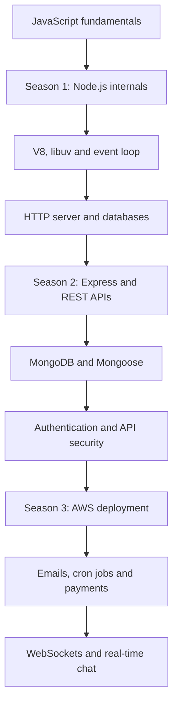

<div align="center">

# 🚀 Namaste Node.js — Handwritten Notes

**Understand the runtime. Build backend APIs. Deploy real applications.**

A community study companion for the [Namaste Node.js course](https://namastedev.com/learn/namaste-node) by Akshay Saini.

[](https://nodejs.org/en/learn)
[](https://expressjs.com/)
[](https://www.mongodb.com/docs/)
[](https://docs.aws.amazon.com/)
[](https://socket.io/docs/v4/)

[](https://github.com/shanmuga-priya-tech/NamasteNodeJSNotes/stargazers)
[](https://github.com/shanmuga-priya-tech/NamasteNodeJSNotes/forks)
[](https://github.com/shanmuga-priya-tech/NamasteNodeJSNotes/issues)


[**Read the notes**](#quick-access) · [Learning roadmap](#learning-roadmap) · [Episode index](#episode-index) · [Interview prep](#interview-preparation) · [Contribute](#contributing)

</div>

---

This repository contains handwritten PDF notes collected across three seasons of Namaste Node.js. Use it alongside the course, as a quick reference while building projects, or to revisit backend concepts before interviews. The original handwritten notes are maintained by [Shanmuga Priya](https://github.com/shanmuga-priya-tech).

## Quick access

Read a complete season without cloning the repository. Open a PDF and use GitHub's download option to save it offline.

| Season | Focus | Combined notes | Episode index |
| :--- | :--- | :---: | :---: |
| **01 — Foundations** | Node internals, event loop, HTTP and databases | [Read PDF](./season1%20full%20notes.pdf) | [13 topics](#season-1) |
| **02 — Backend development** | Express, MongoDB, APIs and authentication | [Read PDF](./namaste%20nodejs%20season2.pdf) | [14 topics](#season-2) |
| **03 — Production** | Deployment, emails, payments and real-time chat | [Read PDF](./Namaste%20Nodejs%20season3-compressed.pdf) | [9 topics](#season-3) |

> [!TIP]
> New to backend development? Start with Season 1. Already building Express APIs? Jump to Season 2 or 3. Use the episode index to revisit a specific concept.

## Learning roadmap



## Episode index

Expand a season to find its individual notes. The topic summaries are study cues, not a verified page-by-page description of each PDF.

### Season 1

<details>
<summary><strong>Season 1 · Node.js fundamentals and internals · 13 topics</strong> (click to expand)</summary>

**[Open combined season PDF](./season1%20full%20notes.pdf)**

| # | Episode | Study focus | Notes |
| :---: | :--- | :--- | :---: |
| 01 | Introduction to Node.js | Runtime and its purpose | [PDF](./Episode-01.pdf) |
| 02 | JavaScript on the server | Server-side JavaScript | [PDF](./Episode-02.pdf) |
| 03 | Writing your first Node.js code | Running JavaScript with Node | [PDF](./Episode-03.pdf) |
| 04 | Modules and require | CommonJS and module.exports | [PDF](./Episode-04.pdf) |
| 05 | Exploring the Node.js source code | Runtime architecture | [PDF](./Episode-05.pdf) |
| 06 | libuv and asynchronous I/O | Non-blocking operations | [PDF](./Episode-06.pdf) |
| 07 | Sync, async and setTimeout(0) | Execution order and scheduling | [PDF](./Episode-07.pdf) |
| 08 | Inside the V8 engine | JavaScript execution | [PDF](./Episode-08.pdf) |
| 09 | libuv and the event loop | Event loop phases | [PDF](./Episode-09.pdf) |
| 10 | The libuv thread pool | Background work and concurrency | [PDF](./Episode-10.pdf) |
| 11 | Creating an HTTP server | Requests and responses | [PDF](./Episode-11.pdf) |
| 12 | SQL and NoSQL databases | Database models | [PDF](./Episode-12.pdf) |
| 13 | Creating a MongoDB database | Database setup | No standalone PDF listed* |

*Episode 13 appears in the curriculum, but a standalone file is not listed. Check the [combined Season 1 PDF](./season1%20full%20notes.pdf) for coverage.

</details>

### Season 2

<details>
<summary><strong>Season 2 · Building backend applications · 14 topics</strong> (click to expand)</summary>

**[Open combined season PDF](./namaste%20nodejs%20season2.pdf)**

| # | Episode | Study focus | Notes |
| :---: | :--- | :--- | :---: |
| 01 | Microservices vs. monoliths | Architecture trade-offs | [PDF](./Season%202%20episode1.pdf) |
| 02 | Features, HLD, LLD and planning | System and API design | [PDF](./Season%202%20episode%202.pdf) |
| 03 | Creating an Express server | Application setup | [PDF](./Season2%20episode%203.pdf) |
| 04 | Routing and request handlers | HTTP methods and routes | [PDF](./Season%202%20episode%204.pdf) |
| 05 | Middleware and error handling | Request lifecycle | [PDF](./Season2%20episode%205.pdf) |
| 06 | Databases, schemas and models | Mongoose ODM | [PDF](./Season%202%20episode%206.pdf) |
| 07 | Building APIs | CRUD operations | [PDF](./Season%202%20episode%207.pdf) |
| 08 | Data sanitization and schema validation | Input validation | [PDF](./Season%202%20episode%208.pdf) |
| 09 | Password hashing | Secure password storage | [PDF](./season%202%20episode%209.pdf) |
| 10 | Authentication, JWT and cookies | Identity and sessions | [PDF](./season2%20episode%2010.pdf) |
| 11 | Express Router | Modular routes | [PDF](./season%202%20episode%2011.pdf) |
| 12 | MongoDB indexes and Mongoose middleware | Query performance and hooks | [PDF](./season2%20episode%2012.pdf) |
| 13 | References, populate and API design | Relationships and API planning | [PDF](./season2%20episode%2013.pdf) |
| 14 | Pagination | Limit and offset | [PDF](./season%202%20episode%2014.pdf) |

</details>

### Season 3

<details>
<summary><strong>Season 3 · Deployment and advanced features · 9 topics</strong> (click to expand)</summary>

**[Open combined season PDF](./Namaste%20Nodejs%20season3-compressed.pdf)**

| # | Episode | Study focus | Notes |
| :---: | :--- | :--- | :---: |
| 01 | Deploying the frontend on AWS | Frontend hosting | [PDF](./season3episode1.pdf) |
| 02 | Deploying the backend on AWS | Connecting frontend and backend | [PDF](./season3%20epidose2.pdf) |
| 03 | Adding a custom domain | DNS and domain configuration | [PDF](./season3%20episode3.pdf) |
| 04 | Securing application secrets | Environment variables | [PDF](./season3%20episode4.pdf) |
| 05 | Sending emails with Amazon SES | Transactional emails | [PDF](./season3%20episode5.pdf) |
| 06 | Scheduling cron jobs | Recurring tasks | [PDF](./season3%20episode6.pdf) |
| 07 | Integrating Razorpay | Payments | [PDF](./season%203%20episode7%20.pdf) |
| 08 | WebSockets and Socket.IO | Real-time communication | [PDF](./season3%20episode%208.pdf) |
| 09 | Building a real-time chat | Chat application | [PDF](./season%203%20episode%209.pdf) |

</details>

## Practice as you learn

| Milestone | Try building | You are ready to move on when… |
| :--- | :--- | :--- |
| Season 1 | A small HTTP server without Express | You can explain how asynchronous I/O works and handle a request. |
| Season 2 | A user API with authentication and a database | You can validate input, hash passwords, protect routes and paginate results. |
| Season 3 | Deploy the API and add a real-time feature | You can configure secrets, send an email and handle a socket connection. |

## Interview preparation

<details>
<summary><strong>Node.js internals — 5 self-check questions</strong></summary>

- [ ] Explain how Node.js handles multiple requests without blocking its main JavaScript thread.
- [ ] What is the difference between V8 and libuv?
- [ ] How do timers and asynchronous callbacks interact with the event loop?
- [ ] Which operations may use the libuv thread pool?
- [ ] How do CommonJS modules expose functionality?

</details>

<details>
<summary><strong>Backend APIs and databases — 5 self-check questions</strong></summary>

- [ ] How does Express middleware work, and why does order matter?
- [ ] When would you choose a monolith over microservices?
- [ ] How do authentication and authorization differ?
- [ ] Why should passwords be hashed rather than encrypted for normal password storage?
- [ ] How do indexes, population and pagination affect API design?

</details>

<details>
<summary><strong>Deployment and real-time systems — 5 self-check questions</strong></summary>

- [ ] How do you keep secrets out of Git and configure environment variables in production?
- [ ] What are DNS, HTTPS and a reverse proxy used for?
- [ ] How would you send transactional emails and schedule recurring tasks?
- [ ] Why must payment signatures and webhook events be verified on the backend?
- [ ] When would you choose WebSockets instead of ordinary HTTP polling?

</details>

Copy this checklist into your own notes or a GitHub issue to track your progress. These are suggested revision questions, not official course interview questions.

## Getting started

**Option A — Read online:** use the [quick access](#quick-access) table or expand the [episode index](#episode-index).

**Option B — Read offline:** clone the repository using Git:

```bash
git clone https://github.com/shanmuga-priya-tech/NamasteNodeJSNotes.git
cd NamasteNodeJSNotes
```

Open the PDF files in your preferred viewer. No npm installation is required to read the notes. You can also use **Code → Download ZIP** on GitHub.

## Official resources

| Technology | Documentation |
| :--- | :--- |
| JavaScript | [MDN JavaScript guide](https://developer.mozilla.org/en-US/docs/Web/JavaScript/Guide) |
| Node.js | [Node.js Learn](https://nodejs.org/en/learn) |
| Express | [Express documentation](https://expressjs.com/) |
| MongoDB | [MongoDB documentation](https://www.mongodb.com/docs/) |
| Mongoose | [Mongoose documentation](https://mongoosejs.com/docs/) |
| AWS | [EC2 documentation](https://docs.aws.amazon.com/ec2/) · [SES documentation](https://docs.aws.amazon.com/ses/) |
| Scheduling | [node-cron documentation](https://nodecron.com/) |
| Payments | [Razorpay documentation](https://razorpay.com/docs/) |
| Real-time | [Socket.IO documentation](https://socket.io/docs/v4/) |

## Contributing

Corrections and thoughtful improvements are welcome. Helpful contributions include fixing broken links, correcting technical inaccuracies, adding original study notes, and improving navigation or accessibility.

1. [Fork this repository](https://github.com/shanmuga-priya-tech/NamasteNodeJSNotes/fork).
2. Clone your fork (replace `YOUR_USERNAME` with your GitHub username).

   ```bash
   git clone https://github.com/YOUR_USERNAME/NamasteNodeJSNotes.git
   cd NamasteNodeJSNotes
   git switch -c docs/improve-notes
   ```

3. Make a focused change. Verify filenames, PDF links and technical accuracy.
4. Commit and push your changes.

   ```bash
   git add README.md
   git commit -m "docs: improve notes navigation"
   git push -u origin docs/improve-notes
   ```

   Stage other files explicitly if your contribution includes them.
5. Open a pull request to the original repository's `main` branch. Describe the problem, your changes and how you verified them.

For larger changes, consider [opening an issue](https://github.com/shanmuga-priya-tech/NamasteNodeJSNotes/issues) first. Please do not submit paid course materials, private credentials or content you do not have permission to share.

## Credits and license

- **Course:** [Namaste Node.js](https://namastedev.com/learn/namaste-node), taught by Akshay Saini at NamasteDev.
- **Original handwritten notes and repository:** [Shanmuga Priya](https://github.com/shanmuga-priya-tech).

These are community study notes, not a replacement for the official course. The previous README states that the project is MIT-licensed, but a separate LICENSE file was not visible in the repository listing when this index was prepared. Please confirm licensing with the maintainer before redistributing the material; rights to third-party course content remain with their respective owners.

---

<div align="center">

If these notes helped you, consider starring the original repository to support its maintainer.

[Back to quick access](#quick-access)

</div>
